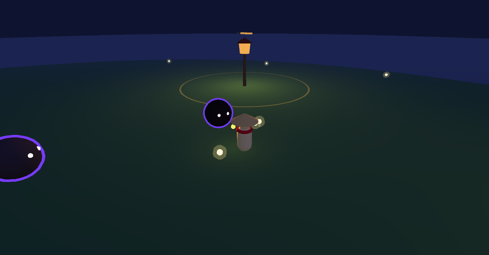

# Đảo Đèn Lồng

> **Video demo:** [Release v1.0.0 → demo.mp4](https://github.com/nthgiang311/K5-L3A-DAY12-NguyenThiHuongGiang-2A202603538-AI-SDLC-Dao-Den-Long/releases/tag/v1.0.0)
> Nguyễn Thị Hương Giang · 2A202603538 · Day 12 AI SDLC · Đề bài lab: [docs/lab/](docs/lab/README-lab.md)

Game 3D góc nhìn thứ ba. Mây – người giữ đèn nhỏ đội nón lá – gom đom đóm qua **3 Đêm** (Đảo Bến, Đảo Cau, Đảo Chuông),
thắp và **giữ** các Đèn Lồng Lớn sáng tới bình minh, né Bóng Mực hút dầu và Gió Lạc cướp đom đóm.
Viết bằng JavaScript: logic thuần (`src/sim/`) dùng chung cho bản 3D (three.js, trình duyệt) và chế độ headless theo **Test Contract v1.3**.



## Yêu cầu hệ thống
- **Node.js ≥ 18** (macOS / Linux / Windows). Không cần cài gì khác ngoài `three` (npm).
- Trình duyệt có WebGL2: Chrome / Edge / Firefox / Safari bản gần đây. Bench cần **Chrome, Chromium hoặc Edge** (hoặc đặt `CHROME_PATH`).

## Cài đặt và chạy (3 lệnh)
```bash
git clone https://github.com/nthgiang311/K5-L3A-DAY12-NguyenThiHuongGiang-2A202603538-AI-SDLC-Dao-Den-Long.git dao-den-long && cd dao-den-long
npm install
node server.js          # mở http://localhost:8080
```
Bản Release v1.0.0 (`dao-den-long-v1.0.0.zip`) có sẵn three.js: giải nén rồi chỉ cần `node server.js`.

## Điều khiển (đổi được trong Cài đặt → Phím)
| Phím mặc định | Hành động |
|---|---|
| W A S D | Đi (theo hướng camera) |
| Space | Nhảy |
| Shift | Lướt |
| E | Nạp đom đóm / châm dầu cho đèn |
| F | Tỏa Sáng (tốn 3 đom đóm) |
| ← / → hoặc kéo chuột | Xoay camera |
| Esc (hoặc P) | Tạm dừng: Tiếp tục / Chơi lại Đêm / Cài đặt / Về menu |

**Cài đặt (được lưu):** âm lượng, độ nhạy chuột, đổi phím (báo trùng phím, nút Khôi phục mặc định), **bảng màu dễ phân biệt** (mù màu),
**giảm chuyển động** (tắt rung camera và chớp màn hình), **chữ lớn ×1,25**. Phụ đề/chỉ báo hình ảnh: Bóng Mực xuất hiện (+ mũi tên ở mép màn hình), gió sắp thổi, 10 giây cuối, đèn sắp cạn dầu.

## Luật chơi và cách tính điểm
- **Mục tiêu mỗi Đêm: giữ đảo sáng tới bình minh.** Thắng nếu còn sống khi hết giờ (240/270/300 s) và số đèn **đang sáng** ≥ 60 % (3/5, 4/6, 5/7).
- Đèn mới cần **10** đom đóm, đèn đã tắt thắp lại cần **5**. Đèn sáng có **dầu 100**, hao 1/s; bấm **E** để châm (+10 dầu/đom đóm). Dầu < 30: nhấp nháy, mất vùng an toàn.
- Mang tối đa **10 + 2 × số lần thắp thành công** (tối đa 20). **Bóng Mực** đuổi trong 12 m, hút dầu đèn yếu; bị chạm: −1 Ngọn Lửa (có 3), rơi một nửa đom đóm.
- **Tỏa Sáng:** 3 đom đóm, bán kính 5 m, choáng 2 s, đẩy lùi 4 m. **Lướt:** 14 m/s × 0,2 s. **Rơi khỏi đảo:** −1 Ngọn Lửa, mất hết đom đóm.
- Đêm 2 có cầu tre, bục nhảy, **Gió Lạc** (cướp 3 đom đóm) và **Bùa Gió**; Đêm 3 có 3 tầng, dốc, tháp chuông, gió mạnh.
- **Điểm:** +5 mỗi đom đóm nạp/châm · +100 thắp lần đầu · +40 thắp lại · +5 mỗi Bóng Mực trúng Tỏa Sáng (+15 nếu đang hút dầu) · thắng: mỗi đèn sáng +50 + dầu còn lại, mỗi Ngọn Lửa +50. Tổng = các Đêm đã thắng.
- **Bảng xếp hạng:** sau Bình Minh hoặc khi thua có thể nhập tên (3–12 ký tự, hỗ trợ tiếng Việt) để lưu; top 10 lưu trên đĩa (`data/leaderboard.json`), xem từ menu chính.

Mọi số tuning ở `game.contract.json` (code đọc trực tiếp). Giả định: [docs/notes/](docs/notes/). Quyết định thiết kế: [docs/adr/](docs/adr/). Thay đổi phá vỡ tương thích: [CHANGELOG.md](CHANGELOG.md).

## Test, headless, bench, soak
```bash
npm test                 # 65 test: luật chơi, CLI headless, exit code, tất định, bảng xếp hạng, soak ngắn
npm run proof            # scenario cho từng yêu cầu + hiệu năng + tất định -> docs/proof/phase-4/SUMMARY.md
node src/headless.js --seed 42 --night 1 --ticks 18000 --out out.jsonl \
  --scenario tests/scenarios/win_run.scenario.json --inputs tests/scenarios/win_run.inputs.json
node scripts/bench.js --seed 42 --duration 30 --out bench.json              # bench_cmd (mở cửa sổ trình duyệt 1280x720)
node --expose-gc --jitless scripts/soak.js --seed 7 --nights 10 --out soak.json   # soak_cmd
node server.js --export-leaderboard out.json                                 # xuất bảng xếp hạng
```
- Headless: `--night` 1/2/3; exit 0 khi xong, 2 khi inputs/scenario sai định dạng, 1 cho lỗi khác. Một Đêm đầy đủ chạy ~1 s.
- **Bench:** khởi động server, mở Chrome/Chromium/Edge thật ở cửa sổ 1280×720 (canvas 1280×720, pixel ratio 1), **vsync tắt** bằng `--disable-gpu-vsync --disable-frame-rate-limit`. `peak_mem_mb` = RSS của cả cây tiến trình trình duyệt (macOS/Linux đo mỗi 3 s bằng `ps`; Windows đo một lần ngay sau khi đo FPS bằng `wmic`).
- **Soak** dùng `--jitless`: bộ nhớ tăng khi bật JIT là mã máy JIT của V8, không phải rò rỉ (đo 30 Đêm không tăng tiếp) – số đo và lý do trong [docs/notes/phase-4.md](docs/notes/phase-4.md).
- CI (GitHub Actions, Ubuntu + macOS, Node 18 + 22) chạy test và kiểm tra bằng chứng tái lập được ở mỗi lần push. Kết quả máy dev: [bench.json](bench.json), [soak.json](soak.json).

## Sáng tạo của tôi
- **Đèn trên nón của Mây sáng theo số đom đóm đang mang**, nhấp nháy khi đang bất tử.
- **Đảo ấm dần** khi đèn sáng; vòng an toàn hiện trên mặt đất; vòng tiến độ nạp quanh cột đèn.
- **Ông Đăng** dẫn chuyện ở màn giới thiệu mỗi Đêm; đom đóm rơi nhấp nháy khi sắp tắt; Bóng Mực mới "trồi lên" to dần.
- Toàn bộ âm thanh **tổng hợp bằng WebAudio** (không dùng file ngoài).

Tất cả chỉ ở `web/` (hiển thị/âm thanh), không chạm `src/sim/`, nên output headless không đổi – bằng chứng: `npm test` và hash tất định trong `docs/proof/`.

## Tài liệu
- Ghi chép từng phase: [docs/notes/](docs/notes/) · Nhật ký dùng AI: [docs/notes/ai-log.md](docs/notes/ai-log.md) · **Retro:** [docs/retro.md](docs/retro.md)
- Bằng chứng: [docs/proof/](docs/proof/) (mỗi phase một thư mục, khớp tag)
- Harness AI: [AGENTS.md](AGENTS.md), [CLAUDE.md](CLAUDE.md), hook `.claude/settings.json`, skill `.claude/skills/verify/`, CI `.github/workflows/ci.yml`
- [CHANGELOG.md](CHANGELOG.md) · [CREDITS.md](CREDITS.md) · [LICENSE](LICENSE)
